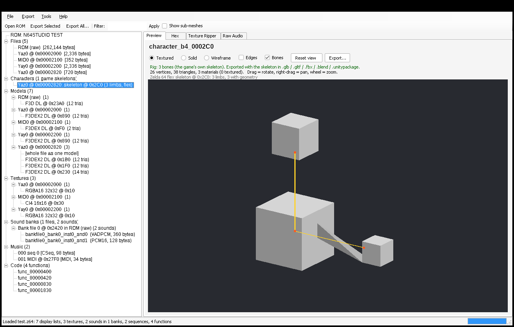

# N64 Asset Studio

A Windows desktop program that opens Nintendo 64 ROMs, finds the 3D models, textures,
sounds, music and code inside them, lets you preview everything, and exports it to the
formats you'd use in Blender, Unity or other tools.

**It's a single `N64AssetStudio.exe`.** Nothing else needs to be installed: no Python, no .NET runtime, no DLLs.



## What it does

| | |
|---|---|
| **ROM formats** | `.z64` (big endian), `.v64` (byte-swapped), `.n64` (little endian), plus `.bin` / `.rom` / `.u64` in any of those byte orders, auto-detected. `.d64` / `.ndd` 64DD disk images are scanned as raw data. |
| **ROM info** | Title, game code, region, version, entry point, CIC boot chip, checksum verification, and conversion between `.z64`, `.v64` and `.n64`. |
| **Files** | Finds and unpacks **Yaz0**, **Yay0**, **MIO0**, **gzip**, **zlib** and Rare's **0x1172/0x1173 deflate** blocks. Zelda 64 games (OoT, MM) are split along their real `dmadata` file table. |
| **3D models** | Finds **F3D (Fast3D)**, **F3DEX** and **F3DEX2** display lists, the graphics microcodes used by nearly every N64 game, and replays them to rebuild triangles, UVs, vertex colours, normals and the textures bound while drawing. Works out segment addresses automatically, and you can adjust them by hand. There's an interactive 3D preview with textured, solid and wireframe modes. |
| **Rigging** | Every model is exported **rigged**: a skeleton plus skin weights. **Zelda 64 engine games** (Ocarina of Time, Majora's Mask) store their character skeletons, so those characters appear under **Characters** with the game's real limb hierarchy and joint positions, including Link-style "flex" skinning across joints. Every other model is **rigged automatically**. N64 characters are built from rigid parts, so each part gets a bone where it meets its neighbour, the largest part becomes the body under a `root` bone, and each vertex is weighted 100% to its part. That's the same way the N64 itself moves them. |
| **Textures** | RGBA16, RGBA32, CI4, CI8 (with palettes), IA4, IA8, IA16, I4, I8 and YUV16. Textures used by models are listed automatically. The **Texture Ripper** shows any data as any format, for games where automatic discovery fails. |
| **Sound** | libultra sound banks (`.ctl`). Their wave tables (`.tbl`) are found automatically, and samples are decoded from **VADPCM** or 16-bit PCM. The VADPCM decoder's output matches the SDK decoder exactly. You can play samples in the app. **Raw Audio** explorer for custom sound engines. |
| **Music** | Standard MIDI files, plus libultra **compressed MIDI** (`S1` sequence banks) converted to standard `.mid`. |
| **Code** | MIPS R4300i disassembler. Lists functions and shows each one as assembly plus a line-by-line pseudo-C translation. |

### Export formats

* **Models:** glTF 2.0 (`.glb` / `.gltf`), **FBX** (binary 7.4), OBJ+MTL, COLLADA `.dae`, PLY, STL. Rigs are kept in `.glb`, `.gltf`, `.fbx`, `.blend` and `.unitypackage`. Blender imports them as an armature with vertex groups; Unity imports them as a Generic rig.
* **Blender:** a native **`.blend`** with every model in its own collection and textures packed in. This uses your installed Blender (found automatically or set in Settings). Without Blender, you get the `.glb` files plus a one-click import script.
* **Unity:** a **`.unitypackage`** containing models (FBX/OBJ/GLB), textures (PNG), sounds (WAV) and music. Import it with *Assets > Import Package*.
* **Images:** PNG, BMP, TGA, TIFF, DDS, ICO, QOI, PPM
* **Audio:** WAV, AIFF, FLAC, AU and raw PCM built in. OGG, MP3, OPUS, M4A and WMA need [ffmpeg](https://ffmpeg.org) installed.
* **Instrument banks:** **SoundFont 2 (`.sf2`)**. Use it with the exported `.mid` files to play the game's music with its own instruments.
* **Music:** `.mid` and raw `.seq`
* **Code:** `.c` (pseudo-C) and `.s` (assembly)

**Export All** writes everything in one go, sorted into `Models/`, `Textures/`, `Audio/`, `Music/` and so on, and can also build the Unity package and the `.blend` in the same pass.

## Getting the program

### Download
**[Download N64AssetStudio.exe](https://github.com/Bacon-Guyderp/Altdispenserapp/releases/latest/download/N64AssetStudio.exe)** (latest release)

Every build that passes its tests is published automatically on the [Releases](https://github.com/Bacon-Guyderp/Altdispenserapp/releases) page.

It runs on 64-bit Windows 10 and 11. Windows SmartScreen may warn about an unsigned download. Choose *More info > Run anyway*.

### Build it yourself
Building needs the free [.NET 8 SDK](https://dotnet.microsoft.com/download/dotnet/8.0). Running the result doesn't.
Double-click **`build_windows.bat`**, or run:
```
dotnet publish src\N64AssetStudio -c Release -o publish
```
The program is written to `publish\N64AssetStudio.exe`.

## Using it

1. **File > Open ROM** (Ctrl+O), or drag a ROM onto the window or onto `N64AssetStudio.exe`.
2. Browse the tree: *Files, Models, Textures, Sound banks, Music, Code*.
3. Select an item to preview it. Drag to rotate models, right-drag to pan, and use the mouse wheel to zoom. Press **Play** to hear sounds.
4. **Export Selected** (Ctrl+E, or double-click an item) and pick a format from the *Save as type* list. For example, choose `.blend` or `.unitypackage` when saving a model.
5. **Export > Export All Assets...** (Ctrl+Shift+E) exports everything.

### Command line
```
N64AssetStudio.exe --cli info  game.z64
N64AssetStudio.exe --cli export game.z64 C:\out --models fbx --audio flac --unity --blender --code
                    (add --no-rig to export models without skeletons)
N64AssetStudio.exe --cli make-test-rom C:\out     (writes a synthetic test ROM)
```

## Limits: please read

There is no standard file format on the N64. Each studio stored data its own way and
linked it together at run time in game code. This tool decodes the formats that are
common across the library, and that covers a large share of games. It still can't
understand every custom engine automatically:

* **Models** are found through their display lists. Games with custom microcodes have models these scanners can't find. Examples include some Factor 5, Boss Game Studios and Rare titles. Their textures can usually still be pulled out with the Texture Ripper.
* **Rigs and animation:** real skeletons are read only for Zelda 64 engine games. Every other game gets an automatic rig, which is ready to pose and animate but uses generated joint positions and bone names. Animations aren't exported. A model that's one continuous piece gets a single body bone, so it can be moved as a whole but not bent; rigging it in finer detail is up to you in Blender. Unity's "Humanoid" avatar needs its bones mapped by hand.
* Some files point into data in other files or into RAM (for example shared "gameplay_keep" textures in Zelda). When that data can't be found, the triangles are still exported but untextured, and the model view lists the segment it couldn't resolve.
* **Audio:** the libultra `B1` bank format is fully supported. Nintendo's in-house engine used by *Super Mario 64*, *Ocarina of Time* and others, and custom engines such as Rare's or Factor 5's MusyX, use other formats. For those, use **Raw Audio** or export the raw files.
* The **pseudo-C** is a readable line-by-line translation of the machine code. It is not a full decompilation that you could recompile.

Only use ROMs you have dumped from cartridges you own.

## Development

The project is written in C# / .NET 8 with Windows Forms:

```
src/N64AssetStudio.Core/     all decoding and exporting (cross-platform, no Windows dependencies)
  Rom.cs, Compression.cs, Games.cs, F3D.cs, Texture.cs, Audio.cs, Sequence.cs, Mips.cs, Project.cs
  Rigging.cs  Zelda 64 skeleton reader + automatic rigger
  Export/  glTF, FBX, OBJ, DAE, PLY, STL, image encoders, WAV/AIFF/FLAC, SoundFont, Blender, Unity, batch
  Render/  software 3D renderer used by the preview
  TestRom.cs  builds a synthetic ROM (real Yaz0/Yay0/MIO0 encoders, F3D/F3DEX/F3DEX2 models, VADPCM bank,
              compressed MIDI, MIPS code) so everything can be tested without copyrighted data
src/N64AssetStudio/          the Windows GUI (single-file self-contained .exe)
src/N64AssetStudio.Cli/      cross-platform command-line build of the same tool
tests/N64AssetStudio.Tests/  xUnit end-to-end tests:  dotnet test
```

`N64AssetStudio.exe --selftest <rom> <outdir>` opens a ROM, clicks through every asset type in the GUI, saves a screenshot of each view and fails on any decode error. CI runs it on Windows for every push.
