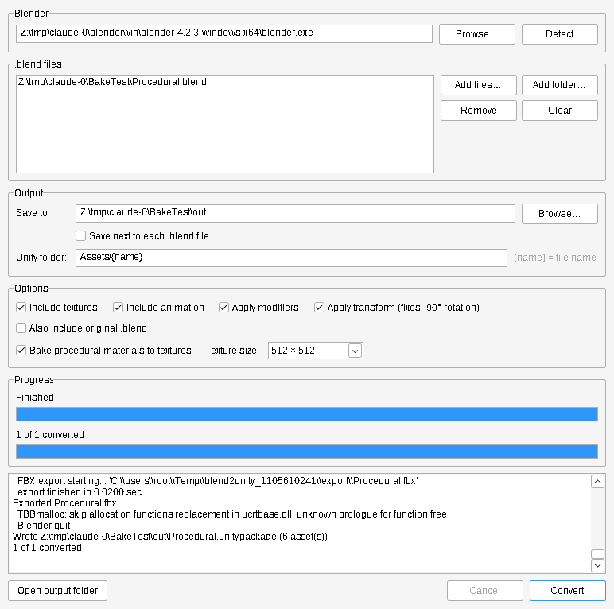

# Blend2Unity

A Windows app, a single `Blend2Unity.exe`, that converts Blender `.blend`
files into Unity `.unitypackage` files. It shows progress for each file and for the whole batch.

**[Download Blend2Unity.exe](https://github.com/Bacon-Guyderp/Altdispenserapp/releases/tag/blend2unity-v1.0.0)**



## Requirements

- **Windows 10 or 11** (64-bit). The exe is a native program: there's no .NET, Python or other
  runtime to install. Just download it and run it.
- **[Blender](https://www.blender.org/download/)** 2.93 or newer. Only Blender can read `.blend` files,
  so the app runs it in the background. It finds normal and Steam installs automatically, or you can
  point it at `blender.exe`.

## Usage

1. Run `Blend2Unity.exe`. Check that the **Blender** path is correct; use **Detect** or **Browse…** if it isn't.
2. Add `.blend` files with **Add files…** or **Add folder…**, or drag files or folders onto the window.
   You can also drop `.blend` files onto `Blend2Unity.exe` itself.
3. Pick an output folder, or tick **Save next to each .blend file**.
4. Click **Convert**. The top bar shows the current file's progress and the bottom bar shows the whole batch.
   **Cancel** stops right away. The log shows Blender's output and any warnings, such as missing textures.
5. In Unity, use **Assets → Import Package → Custom Package…** and pick the `.unitypackage`.

| Option | Effect |
| --- | --- |
| Unity folder | Where assets go inside the Unity project. `{name}` is replaced by the file name. |
| Include textures | Copy every image the materials use, including packed and painted images, into `Textures/`. |
| Include animation | Bake actions and animations into the FBX. |
| Apply modifiers | Export meshes with their modifiers applied. |
| Apply transform | Bake the axis conversion so objects don't import with a -90° X rotation. |
| Also include original .blend | Ship the `.blend` too. Unity can only import it if Blender is installed. |

Settings are saved in `%APPDATA%\Blend2Unity\settings.ini`.

## How it works

1. For each file, Blender runs in the background with `blender_export.py`, which is built into
   the exe. It writes an FBX set up for Unity (Y-up, -Z forward, unit scale applied, no leaf bones)
   and copies the textures into `Textures/`.
2. The app packs them into a `.unitypackage` under `Assets/<file name>/`. A `.unitypackage` is a
   tar.gz with one folder per asset. Asset GUIDs come from each asset's path, so importing an updated
   package replaces the old assets instead of making duplicates.

## Building

The app is written in Go and uses the Windows API directly, so there are no dependencies.
With [Go](https://go.dev/dl/) 1.21+ installed, on any OS:

```sh
GOOS=windows GOARCH=amd64 go build -trimpath -ldflags "-s -w -H windowsgui" -o Blend2Unity.exe .
```

(On Windows `cmd`, run `set GOOS=windows` and `set GOARCH=amd64` first.) `rsrc_windows_amd64.syso`
holds the icon, manifest and version info and is linked in automatically. It is built from `winres/`
with `x86_64-w64-mingw32-windres -O coff -i app.rc -o ../rsrc_windows_amd64.syso`, run inside `winres/`.

The GitHub Actions workflow builds the exe on every push. Pushing a tag like `blend2unity-v1.0.1` publishes a GitHub Release with the exe attached.

On Linux and macOS the same code builds as a command-line tool: `go build -o blend2unity .`, then run
`blend2unity -o out/ model.blend`.

## Tests

```sh
go test ./...                                   # package-format tests
BLENDER_PATH=/path/to/blender go test ./...     # plus end-to-end conversions with Blender
```

## Source

- `gui_windows.go`, `win32_windows.go`: the window, built directly on the Windows API
- `converter.go`: finds and runs Blender and parses its progress
- `unitypackage.go`: `.unitypackage` writer
- `blender_export.py`: export script that runs inside Blender (embedded in the exe)
- `main_other.go`: command-line version for Linux and macOS
