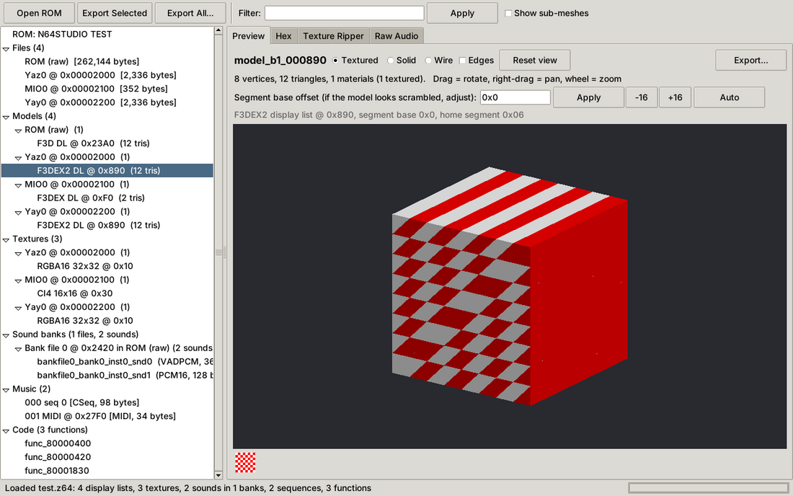

# N64 Asset Studio

A Windows desktop program that opens Nintendo 64 ROMs, finds the 3D models, textures,
sounds, music and code inside them, lets you preview everything, and exports it to the
formats you'd use in Blender, Unity or other tools.



## What it does

| | |
|---|---|
| **ROM formats** | `.z64` (big endian), `.v64` (byte-swapped), `.n64` (little endian), plus `.bin` / `.rom` / `.u64` in any of those byte orders, auto-detected. `.d64` / `.ndd` 64DD disk images are scanned as raw data. |
| **ROM info** | Title, game code, region, version, entry point, CIC boot chip, checksum verification, and conversion between `.z64`, `.v64` and `.n64`. |
| **Files** | Finds and unpacks **Yaz0**, **Yay0**, **MIO0**, **gzip**, **zlib** and Rare's **0x1172/0x1173 deflate** blocks. Zelda 64 games (OoT, MM) are split along their real `dmadata` file table. |
| **3D models** | Finds **F3D (Fast3D)**, **F3DEX** and **F3DEX2** display lists, the graphics microcodes used by nearly every N64 game, and replays them to rebuild triangles, UVs, vertex colours, normals and the textures bound while drawing. Works out segment addresses automatically, and you can adjust them by hand. There's an interactive 3D preview with textured, solid and wireframe modes. |
| **Textures** | RGBA16, RGBA32, CI4, CI8 (with palettes), IA4, IA8, IA16, I4, I8 and YUV16. Textures used by models are listed automatically. The **Texture Ripper** shows any data as any format, for games where automatic discovery fails. |
| **Sound** | libultra sound banks (`.ctl`). Their wave tables (`.tbl`) are found automatically, and samples are decoded from **VADPCM** or 16-bit PCM. The VADPCM decoder's output matches the SDK decoder exactly. You can play samples in the app. **Raw Audio** explorer for custom sound engines. |
| **Music** | Standard MIDI files, plus libultra **compressed MIDI** (`S1` sequence banks) converted to standard `.mid`. |
| **Code** | MIPS R4300i disassembler. Lists functions and shows each one as assembly plus a line-by-line pseudo-C translation. |

### Export formats

* **Models:** glTF 2.0 (`.glb` / `.gltf`), **FBX** (binary 7.4), OBJ+MTL, COLLADA `.dae`, PLY, STL
* **Blender:** a native **`.blend`** with every model in its own collection and textures packed in. This uses your installed Blender (found automatically or set in Settings). Without Blender, you get the `.glb` files plus a one-click import script.
* **Unity:** a **`.unitypackage`** containing models (FBX/OBJ/GLB), textures (PNG), sounds (WAV) and music. Import it with *Assets > Import Package*.
* **Images:** PNG, BMP, TGA, TIFF, GIF, WEBP, JPG, DDS, ICO, PPM, PCX, QOI
* **Audio:** WAV, AIFF, FLAC, AU and raw PCM built in. OGG, MP3, OPUS, M4A and WMA need [ffmpeg](https://ffmpeg.org) installed.
* **Instrument banks:** **SoundFont 2 (`.sf2`)**. Use it with the exported `.mid` files to play the game's music with its own instruments.
* **Music:** `.mid` and raw `.seq`
* **Code:** `.c` (pseudo-C) and `.s` (assembly)

**Export All** writes everything in one go, sorted into `Models/`, `Textures/`, `Audio/`, `Music/` and so on, and can also build the Unity package and the `.blend` in the same pass.

## Getting the program

### Option 1: Download the .exe
Every push to this repository builds `N64AssetStudio.exe` in GitHub Actions. Open the **Actions** tab, then the latest *Build Windows app* run, and download the **N64AssetStudio-windows** artifact. Pushing a tag such as `v1.0.0` also attaches the `.exe` to a GitHub Release.

### Option 2: Build it yourself
1. Install [Python 3.10+](https://www.python.org/downloads/windows/) and tick *"Add python.exe to PATH"*.
2. Double-click **`build_windows.bat`**. The program is written to `dist\N64AssetStudio.exe`.

### Option 3: Run from source
Double-click **`run.bat`**, or run:
```
pip install -r requirements.txt
python main.py [optional_rom_path]
```
It also runs on Linux and macOS if Tkinter is installed.

## Using it

1. **File > Open ROM** (Ctrl+O), or drag a ROM onto `N64AssetStudio.exe`.
2. Browse the tree: *Files, Models, Textures, Sound banks, Music, Code*.
3. Select an item to preview it. Drag to rotate models, right-drag to pan, and use the mouse wheel to zoom. Press **Play** to hear sounds.
4. **Export Selected** (Ctrl+E, or double-click an item) and pick a format from the *Save as type* list. For example, choose `.blend` or `.unitypackage` when saving a model.
5. **Export > Export All Assets...** (Ctrl+Shift+E) exports everything.

### Command line
```
N64AssetStudio.exe --cli info  game.z64
N64AssetStudio.exe --cli export game.z64 C:\out --models fbx --audio flac --unity --blender --code
```

## Limits: please read

There is no standard file format on the N64. Each studio stored data its own way and
linked it together at run time in game code. This tool decodes the formats that are
common across the library, and that covers a large share of games. It still can't
understand every custom engine automatically:

* **Models** are found through their display lists. Games with custom microcodes have models these scanners can't find. Examples include some Factor 5, Boss Game Studios and Rare titles, and Conker's and Perfect Dark's own variants. Their textures can usually still be pulled out with the Texture Ripper.
* What you get is the **geometry as the game draws it**. Skeletons and animations are stored in each game's own format and aren't exported.
* Some files point into data in other files or into RAM (for example shared "gameplay_keep" textures in Zelda). When that data can't be found, the triangles are still exported but untextured, and the model view lists the segment it couldn't resolve.
* **Audio:** the libultra `B1` bank format is fully supported. Nintendo's in-house engine used by *Super Mario 64*, *Ocarina of Time* and others, and custom engines such as Rare's or Factor 5's MusyX, use other formats. For those, use **Raw Audio** or export the raw files.
* The **pseudo-C** is a readable line-by-line translation of the machine code. It is not a full decompilation that you could recompile. Projects such as the SM64/OoT decompilations took years of manual work per game.
* **Unity** and **Blender** outputs were checked by loading them into Blender's own importers, which read the FBX, glTF, OBJ, PLY and STL exports with geometry, UVs and textures intact. The `.dae` file is written to the COLLADA 1.4.1 spec, but Blender 5 has no COLLADA importer, so it wasn't checked that way.

Only use ROMs you have dumped from cartridges you own.

## Development

```
python -m pytest tests          # 13 end-to-end tests on a synthetic ROM
python tests/make_test_rom.py out   # writes test.z64/.v64/.n64 for manual testing
```

`tests/make_test_rom.py` builds a ROM from scratch. It has real Yaz0, Yay0 and MIO0 encoders, F3D, F3DEX and F3DEX2 display lists, RGBA16 and CI4 textures, a VADPCM sound bank, compressed-MIDI music and MIPS code, so the whole pipeline can be tested without any copyrighted data.

Layout:
```
n64studio/
  rom.py          byte order, header, CIC, CRC
  compression.py  Yaz0 / Yay0 / MIO0 / zlib / gzip / Rare
  games.py        Zelda 64 dmadata file table
  f3d.py          display list detection + interpreter (F3D/F3DEX/F3DEX2)
  texture.py      N64 texture formats
  audio.py        ALBank (.ctl), .tbl location, VADPCM
  sequence.py     MIDI / compressed MIDI -> .mid
  mips.py         R4300i disassembler + pseudo-C
  project.py      scan pipeline and asset catalogue
  export/         glTF, FBX, OBJ, DAE, PLY, STL, images, audio, SF2, Blender, Unity, batch
  gui/            Tkinter UI and software 3D renderer
```
