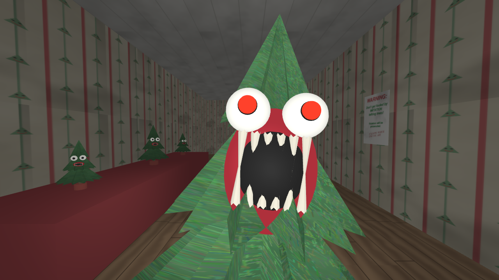

# Fir Warning: a Quest-friendly VRChat horror world about animatronic talking trees

*"Don't get fooled by imitations. Unauthorized copies will not be tolerated."*



It's Christmas Eve, 1996, and the talking-tree factory has shut down for good. The trees never switched off.
You and your friends are the night clean-up crew. You go room by room through the factory and finish
on the Recall Floor, where you burn the "imitation" trees in the furnace while **the Original** hunts you.

* **About 45–50 minutes** for a group playing for the first time, across six puzzle chapters. Every answer is randomised each game.
* **1–8 players**, co-op, and **tuned for duos**: see "Playing with two" below. Progress, doors and items are synced, and late joiners can catch up.
* **About 110 placed jumpscares**, some shared so everyone gets them at the same moment, plus a tree waiting inside every door, plus scares tied to events (finding the last item, wrong answers, getting caught) and random whispers, rustles and flickers every 14–36 seconds (more often when you split up). Any animatronic may snap round and scream as you walk up, picked-up imitations and hats can turn on you, and entering puzzle codes can set off whispers or something behind you.
* **Quest-friendly:** no realtime lights or shadows, no post-processing, one tiny shader, 512 px textures
  (ASTC on Android) and about 1 MB of mono Vorbis audio. The whole package is under 3 MB.

Everything (models, sounds, posters) is generated from code in this folder, so it carries no asset licences.
The songs use *O Tannenbaum*, which is public domain. The company in the world is the fictional
"Evergreen Novelty Corp.". This is a fan-made world and isn't affiliated with any toy company.

## The chapters

| # | Room | Goal | Rough time | What goes wrong |
|---|---|---|---|---|
| — | Lobby | Story, rules, personal options, **START** | 2 min | Nothing. It's the one safe room. |
| 1 | **Showroom: the carol** | Find 3 batteries, power the panel, and the four table trees sing a 5-note carol. Repeat it by touching the trees in the same order | 7 min | The Original greets you, eyes follow you, a hand under the table and a tree behind the curtain, a tree that creeps closer when you look away, and a wrong note screams in your face |
| 2 | **Stockroom: glow paint** | Find 4 fuses. The fuse box wants a 3-digit code painted in **glow paint, visible only in the dark**. Flip the light switch (8 s of darkness) and find the digits, but **the stalker can move while it's dark** | 9 min | The stalker, a screaming crate, a falling box, a creeper in the aisle, and a tree standing at the end of an aisle when the lights come back |
| 3 | **Voice Lab: the tapes** | Collect 4 coloured tapes. The booth card maps colours to session names, and the whiteboard lists the names in order. Play the colours in that order | 8 min | Conveyor heads turn to you, the booth singer screams, something appears beside the whiteboard in a blackout, and a wrong order sets off every tree |
| 4 | **Offices: the memos** | Each memo is a counting riddle for one digit ("count the telephones in the Offices, then add 3"). Count employees, Santa hats, phones and calendars, then enter the code | 9 min | The stalker among the cubicles, two phones ringing, employees turning in their chairs, a creeper in the back aisle and faces in the cubicles |
| 5 | **Living Room: the hats** | A logic clue card on the mantle says who wears which colour hat. Name plaques sit under the trees. Put red, green and blue hats on the right family members | 6 min | Every tree turns to stare when a hat goes on, "THAT'S NOT MY HAT", something behind you at the fireplace, and a blackout reveal at the table |
| 6 | **Recall Floor: the furnace** | Open 3 gas valves to light the furnace, then carry 5 whimpering imitation trees into it | 9 min | **The Original hunts you** and creeps forward even while watched. A tree drops from the ceiling, a chorus of screams, and scares on the valves |
| 7 | Exit | Your time, the credits and the way back to the lobby | — | One last scare |

Every answer (carol, glow digits, tape order and labels, door code, hat clues) is generated from a synced
seed, so groups can't share solutions. If the group is stuck for five minutes, a hint appears under
everyone's view, and another every four minutes after that.

### Scare types
Face scares, something standing behind you that screams when you turn, reveals, drops, peeks that vanish
when you look, group screams with blackouts, flickers, **creepers** (a tree that steps closer every time you
look away, until it reaches you) and **dark reveals** (the lights die, and when they come back a tree is
standing there). Glow-paint messages ("BEHIND YOU", "IT MOVES IN THE DARK") appear on the walls in every
blackout.

New in the latest pass: **chargers** (a tree sprints at you screaming, one per chapter), **mimics** (a battery,
fuse, tape, key, hat or valve that turns out to be a tree), **banging** on every locked door from the far side,
**subliminal flashes** (a face for a split second, no sound) and **HUD glitches** ("Y O U   C A N ' T   L E A V E").

Between the scripted scares, a **scare director** plays sounds just behind you, flickers the lights and
sometimes stages a bigger moment: something standing behind you, or a blackout with laughter. It speeds up
every chapter, and it targets whoever is alone.

### Playing with two
The game counts the players inside the factory and adjusts for small groups:
* With **2 players** the hunting tree moves at 75% speed and has a shorter reach. In the finale it barely
  creeps (0.18 m/s instead of 0.35) while one of you watches it. With **1 player** it moves at 55% speed and
  stops completely when watched.
* The Stockroom lights-out lasts 6 s instead of 8, and the tree moves even slower in the dark.
* Hints come after 3.5 minutes instead of 5, then every 3 minutes.
* The plan for two: one watches the tree, one searches, and you swap often.
* The scare director punishes splitting up. If you're more than 10 m from your partner (or playing alone),
  scares come faster and you get whispered subtitles ("...where did your friend go?").
* Shared scares (blackout reveals, choirs of screaming trees) hit both of you at once, so you can scream together.

### The stalker
The owner of the stalker (normally the instance master) checks every player's head direction each frame,
with a line-of-sight test against the walls. **If anyone is looking at it, it freezes.** If nobody is,
it walks toward the nearest player on a baked NavMesh. You hear it rustle and creak when it moves, and
a heartbeat plays when it's within 7 m. If it reaches you, you get a face scare and you're sent back to the
start of that room. There's no game over, so the 45-minute run keeps going. Closed doors carve the
NavMesh, so it can't follow you into rooms you haven't unlocked.

### Darkness without lights
There isn't a single Light in the world. Every surface uses the `FirHorror/Lantern` shader, which lights
things by how close they are to **your** camera and how near the middle of your view they are. Every
player gets their own torch, at no cost and with correct stereo. Udon drives three global shader values,
which control blackouts, flicker and brightness. Tree eyes have a faint glow, so in a blackout all
you can see is pairs of eyes.

### Easter egg: the closet
The Living Room has a closet marked "do not open". Open it and, for everyone at once, a **red** skeleton steps out
of the dark through green mist, gives a big palms-up shrug, and steps back in, with the subtitle
**RED SKELETON**. It's a tribute to the classic cartoon gag ([this clip](https://www.youtube.com/watch?v=ZuG1woeW3gs)).
The skeleton is built from simple shapes; nothing from the cartoon is used. Code: `Scripts/FirCloset.cs`.

### Throwable toilets
There are two toilets in the lobby and a three-stall staff restroom by the Offices entrance. Pick one up and
throw it. Press **Use** while you hold one to flush it. A hit on the hunting tree makes it scream and freezes it
for 4 seconds, so a teammate with a toilet can cover a friend who's being chased. The toilets go back to their
places when a new game starts. Code: `Scripts/FirToilet.cs`.

### Comfort options (lobby, per player)
* **Brightness:** dark, normal or bright.
* **Flashing lights:** on or off. Off removes the strobing flicker, but blackouts still happen.
* **Jumpscares:** full, or sound only (no faces).

## Setup

1. Create a world project in the **VRChat Creator Companion** (Worlds SDK 3.5 or newer, with UdonSharp).
2. Import **`FirWarning.unitypackage`** with **Assets > Import Package > Custom Package**. Build it with
   `python tools/make_unitypackage.py`. If the package won't import, unzip **`FirWarning-folder.zip`**
   into the project folder instead, so you get `Assets/FirHorror`.
3. Unity asks **"Set up Fir Warning now?"**. Click **Set it up**, or use **Fir Warning > One-Click Setup**
   later. It imports TextMeshPro's essentials, creates and saves `Assets/FirHorror/Fir Warning.unity`, builds
   the world, bakes the NavMesh and adds the scene to Build Settings.
4. **VRChat SDK > Show Control Panel > Builder > Build & Test**. For Quest, switch the platform to
   **Android** and upload the same world again.

**Fir Warning > Build World** rebuilds everything in the open scene, replacing the old `FirWarning` object.
Re-run it after changing the builder, and save the scene first so the NavMesh bake has a home.

### Regenerating the assets
```
cd tools
python make_audio.py       # numpy + ffmpeg: writes Assets/FirHorror/Audio/*.ogg
python make_textures.py    # numpy + Pillow: writes Assets/FirHorror/Textures/*.png
python make_unitypackage.py
```

## How it's built

| Piece | File |
|---|---|
| Story state, doors, items, HUD and subtitles, lighting, face and behind-you scares | `Assets/FirHorror/Scripts/FirGameManager.cs` |
| Talking-tree animatronic (sway, stare, talk, sing, scream, eye tracking) | `Scripts/FirAnimatronic.cs` |
| The tree that moves when unwatched (NavMeshAgent, view checks, synced) | `Scripts/FirStalker.cs` |
| Scripted scares (face, reveal, sound, drop, behind you, group scream, peek, flicker) | `Scripts/FirJumpscare.cs` |
| Random between-scare ambience | `Scripts/FirAmbience.cs` |
| Collectibles, carried items, hat and furnace sockets | `Scripts/FirItem.cs`, `FirCarryItem.cs`, `FirSocket.cs` |
| Tape deck and keypad | `Scripts/FirSequenceLock.cs`, `FirKey.cs` |
| Buttons and the conveyor belt | `Scripts/FirButton.cs`, `FirConveyor.cs` |
| Throwable toilets | `Scripts/FirToilet.cs` |
| The whole world, built from code (rooms, procedural tree meshes, props, NavMesh, descriptor) | `Editor/FirWorldBuilder.cs` |
| One-click setup | `Editor/FirSetup.cs` |
| The lantern shader | `Shaders/FirLantern.shader` |
| Jumpscare preview without Unity (three.js port of the tree, face and lighting) | `tools/preview/` |
| Sound and texture generators, package builder | `tools/` |

### Tuning
* **Length:** the hint timer is `hintAt` in `FirGameManager.EnterPhase` (5 min, then every 4 min). The
  stalker's speeds and catch distance are on the `Stalker` object.
* **Scare density:** every scripted scare is a `Scare …` object under its chapter. Each one is a trigger
  box with a `FirJumpscare`. Move it, change its `kind` or `delay`, or delete it. `FirAmbience.minGap` and
  `maxGap` set how often the random ones happen.
* **Performance:** room geometry is static-batched. If you want more Quest headroom, bake Occlusion Culling
  (**Window > Rendering > Occlusion Culling > Bake**). The walls are already marked as occluders.

### Not tested in Unity yet
This was written without access to Unity or the VRChat SDK, so it hasn't been compiled or played. Expect
some first-run fixes in UdonSharp, and test with at least two people (one PC, one Quest) before publishing.
The likely trouble spots are the stalker's NavMesh, the reach of the tripwire triggers, and hat-socket sizes
in VR.
