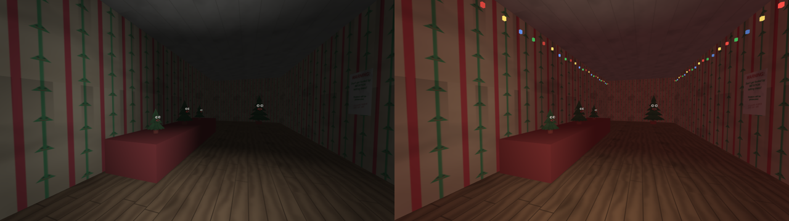
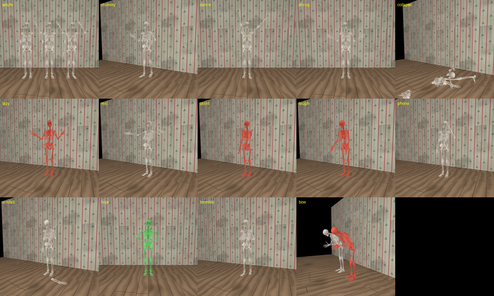

# Fir Warning: a Quest-friendly VRChat horror world about animatronic talking trees

*"Don't get fooled by imitations. Unauthorized copies will not be tolerated."*


It's Christmas Eve, 1996, and the talking-tree factory has shut down for good. The trees never switched off.
You and your friends are the night clean-up crew. You go room by room through the factory and finish
on the Recall Floor, where you burn the "imitation" trees in the furnace while **the Original** hunts you.

* **About 45–50 minutes** for a group playing for the first time, across six puzzle chapters. Every answer is randomised each game.
* **1–8 players**, co-op, and **tuned for duos**: see "Playing with two" below. Progress, doors and items are synced, and late joiners can catch up.
* **About 110 placed jumpscares**, some shared so everyone gets them at the same moment, plus a tree waiting inside every door, plus scares tied to events (finding the last item, wrong answers, getting caught) and random whispers, rustles and flickers every 14–36 seconds (more often when you split up). Any animatronic may snap round and scream as you walk up, picked-up imitations and hats can turn on you, and entering puzzle codes can set off whispers or something behind you.
* **Quest-friendly:** no realtime lights or shadows, no post-processing, one tiny shader, 512 px textures
  (ASTC on Android) and about 1 MB of mono Vorbis audio. The whole package is under 3 MB.

Everything (models, sounds, posters) is generated from code in this folder, so it carries no asset licences.
The songs use *O Tannenbaum*, which is public domain. The company in the world is the fictional
"Evergreen Novelty Corp.". This is a fan-made world and isn't affiliated with any toy company.

## The chapters

| # | Room | Goal | Rough time | What goes wrong |
|---|---|---|---|---|
| — | Lobby | Story, rules, personal options, **START** | 2 min | Nothing. It's the one safe room. |
| 1 | **Showroom: the carol** | Find 3 batteries, power the panel, and the four table trees sing a 5-note carol. Repeat it by touching the trees in the same order | 7 min | The Original greets you, eyes follow you, a hand under the table and a tree behind the curtain, a tree that creeps closer when you look away, and a wrong note screams in your face |
| 2 | **Stockroom: glow paint** | Find 4 fuses. The fuse box wants a 3-digit code painted in **glow paint, visible only in the dark**. Flip the light switch (8 s of darkness) and find the digits, but **the stalker can move while it's dark** | 9 min | The stalker, a screaming crate, a falling box, a creeper in the aisle, and a tree standing at the end of an aisle when the lights come back |
| 3 | **Voice Lab: the tapes** | Collect 4 coloured tapes. The booth card maps colours to session names, and the whiteboard lists the names in order. Play the colours in that order | 8 min | Conveyor heads turn to you, the booth singer screams, something appears beside the whiteboard in a blackout, and a wrong order sets off every tree |
| 4 | **Offices: the memos** | Each memo is a counting riddle for one digit ("count the telephones in the Offices, then add 3"). Count employees, Santa hats, phones and calendars, then enter the code | 9 min | The stalker among the cubicles, two phones ringing, employees turning in their chairs, a creeper in the back aisle and faces in the cubicles |
| 5 | **Living Room: the hats** | A logic clue card on the mantle says who wears which colour hat. Name plaques sit under the trees. Put red, green and blue hats on the right family members | 6 min | Every tree turns to stare when a hat goes on, "THAT'S NOT MY HAT", something behind you at the fireplace, and a blackout reveal at the table |
| 6 | **Recall Floor: the furnace** | Open 3 gas valves to light the furnace, then carry 5 whimpering imitation trees into it | 9 min | **The Original hunts you** and creeps forward even while watched. A tree drops from the ceiling, a chorus of screams, and scares on the valves |
| 7 | Exit | Your time, the credits and the way back to the lobby | — | One last scare |

Every answer (carol, glow digits, tape order and labels, door code, hat clues) is generated from a synced
seed, so groups can't share solutions. If the group is stuck for five minutes, a hint appears under
everyone's view, and another every four minutes after that.

### Scare types
Face scares, something standing behind you that screams when you turn, reveals, drops, peeks that vanish
when you look, group screams with blackouts, flickers, **creepers** (a tree that steps closer every time you
look away, until it reaches you) and **dark reveals** (the lights die, and when they come back a tree is
standing there). Glow-paint messages ("BEHIND YOU", "IT MOVES IN THE DARK") appear on the walls in every
blackout.

New in the latest pass: **chargers** (a tree sprints at you screaming, one per chapter), **mimics** (a battery,
fuse, tape, key, hat or valve that turns out to be a tree), **banging** on every locked door from the far side,
**subliminal flashes** (a face for a split second, no sound) and **HUD glitches** ("Y O U   C A N ' T   L E A V E").

Between the scripted scares, a **scare director** plays sounds just behind you, flickers the lights and
sometimes stages a bigger moment: something standing behind you, or a blackout with laughter. It speeds up
every chapter, and it targets whoever is alone.

### Playing with two
The game counts the players inside the factory and adjusts for small groups:
* With **2 players** the hunting tree moves at 75% speed and has a shorter reach. In the finale it barely
  creeps (0.18 m/s instead of 0.35) while one of you watches it. With **1 player** it moves at 55% speed and
  stops completely when watched.
* The Stockroom lights-out lasts 6 s instead of 8, and the tree moves even slower in the dark.
* Hints come after 3.5 minutes instead of 5, then every 3 minutes.
* The plan for two: one watches the tree, one searches, and you swap often.
* The scare director punishes splitting up. If you're more than 10 m from your partner (or playing alone),
  scares come faster and you get whispered subtitles ("...where did your friend go?").
* Shared scares (blackout reveals, choirs of screaming trees) hit both of you at once, so you can scream together.

### The stalker
The owner of the stalker (normally the instance master) checks every player's head direction each frame,
with a line-of-sight test against the walls. **If anyone is looking at it, it freezes.** If nobody is,
it walks toward the nearest player (no NavMesh: straight at you, or round shelves via a grid of waypoints). You hear it rustle and creak when it moves, and
a heartbeat plays when it's within 7 m. If it reaches you, you get a face scare and you're sent back to the
start of that room. There's no game over, so the 45-minute run keeps going. It never leaves its room.

### Darkness without lights, but with colour
There isn't a single Light in the world. Every surface uses the `FirHorror/Lantern` shader, which lights
things by how close they are to **your** camera and how near the middle of your view they are. Every
player gets their own warm torch, at no cost and with correct stereo. On top of that, each room has its own
**mood colour** that fades in as you walk in: red in the Showroom, sickly green in the Stockroom, purple in the
Voice Lab, cold blue in the Offices (with a fluorescent-white torch), fireplace amber in the Living Room and
furnace orange on the Recall Floor. **Twinkling Christmas lights** (`FirHorror/Bulb`, no Udon needed) run
along every wall; they stay dimly lit in blackouts. Tree eyes have a faint glow, so in a blackout all you
can see is pairs of eyes and the fairy lights.



### Baked-in textures
The package contains no image files for Unity to import. Every texture is baked into one data file,
`Data/textures_baked.txt`, and **Build World** decodes them itself, makes mipmaps, compresses them for the
current platform (ASTC on Android/Quest, DXT1 on PC) and saves them as texture assets in `Generated/`.
Switching platform re-bakes them automatically. So textures can't go missing or show up white because of
an import problem. The source PNGs live in `tools/textures/`.

### Why nothing blocks the pointer
VRChat's interact pointer stops at the first collider it hits, even an invisible trigger. So the world has
**no trigger zones at all**: scares and walk-past gags check your position in code, and the hat and furnace
sockets sit on the Ignore Raycast layer. After every build, **Build World** looks at each interactable from a
ring of standing spots and lists any that something blocks.

### Comedy gags (53)
Between the scares, 53 things around the world want to make you laugh. Press them (or walk past the
peekaboo and waddling ones) and, for everyone at once, they pop up, spin, inflate, flip, fall or waddle
while saying their line in their own voice. They're all listed in `Data/gags.txt`, which the builder
places from and `tools/make_voices.py` records the voices from. Add a line there to add a gag.

**Lobby**
* flip sign: *"Now look what you did."*
* present pop-up: *"Surprise! I'm the present!"*
* spinning tree: *"Wheee! I'm a festive tornado!"*
* inflating ornament: *"Please don't pop me. Please."*
* talking tree: *"I'd tell you a tree joke, but it's a bit sappy."*
* shivering tree: *"Brr! Who left the front door open?"*

**Showroom**
* present pop-up: *"Is it Christmas yet? No? Bye."*
* falling picture: *"Every month. Every single month."*
* flip sign: *"Batteries not included."*
* spinning tree: *"I'm not dizzy. The room is spinning."*
* peekaboo (walk past): *"Is the coast clear? Oh. Hi."*
* talking tree: *"I used to be a pine. Then I got my needles done."*
* inflating tree: *"I've been working out!"*

**Stockroom**
* box pop-up: *"Return to sender!"*
* flip sign: *"We don't even have a forklift."*
* waddling tree (walk past): *"Excuse me. Tiny tree coming through."*
* shivering tree: *"This aisle is haunted. By me. Boo."*
* talking tree: *"I asked for a raise. They gave me a taller pot."*
* inflating box: *"Bubble wrap! Bubble wrap!"*
* spinning tree: *"Inventory complete! I counted myself twice."*

**Voice Lab**
* talking tree: *"Testing. Testing. Is this thing on?"*
* box pop-up: *"Take two!"*
* flip sign: *"Whoops. Wrong side."*
* spinning tree: *"I do all my own stunts!"*
* inflating tree: *"This is my big break!"*
* falling picture: *"Ten copies. Ten!"*
* peekaboo (walk past): *"Did somebody say audition?"*

**Offices**
* flip sign: *"The coffee machine is a tree now."*
* talking tree: *"Did you hear? Gary from accounting got recycled."*
* falling picture: *"I couldn't hang in there."*
* box pop-up: *"I'm not hiding. I'm filing."*
* spinning tree: *"Wheee! Office chair races!"*
* inflating tree: *"I ate the whole holiday party."*
* shivering tree: *"Who set the thermostat to winter?"*

**Living Room**
* falling picture: *"Everyone looks so wooden."*
* present pop-up: *"I wrapped myself. Don't ask how."*
* talking tree: *"Is the fire for warmth? Or for us?"*
* spinning tree: *"Mistletoe? On me? No thank you!"*
* flip sign: *"Not on that mat."*
* inflating ornament: *"Shiny. Round. Terrified."*
* peekaboo (walk past): *"I'm just here for the view."*

**Recall Floor**
* flip sign: *"Just kidding. Mostly."*
* talking tree: *"I'm not an imitation. I'm a tribute."*
* box pop-up: *"Do I look recalled to you?"*
* spinning tree: *"If I spin fast enough, I'm a blender!"*
* inflating tree: *"Too big for the furnace! Ha!"*
* shivering tree: *"It's freezing. Can we light the furnace? Wait. No."*
* waddling tree (walk past): *"I'm just going to... leave."*
* falling picture: *"Zero accidents. Zero survivors."*

**Exit**
* talking tree: *"Leaving so soon? We made cake. Tree cake."*
* flip sign: *"Sequel coming soon."*
* present pop-up: *"Here's your participation trophy. It's me."*
* spinning tree: *"Victory spin!"*

### Skeleton routines (12)
Your skeleton model also turns up for 12 routines of its own (`Data/skeleton_gags.txt`, played by
`Scripts/FirSkeletonGag.cs`). Press one and, for everyone at once, it acts it out while saying its line:

| Where | Routine |
|---|---|
| Lobby | A **skeleton crew** of three salutes in turn: *"Skeleton crew, reporting for duty!"* |
| Lobby | A shimmy: *"I've got a funny bone. It's all of them."* |
| Showroom | Dances wildly, then shrugs: *"I've got no body to dance with."* |
| Stockroom | **Collapses into a pile of bones** and pulls itself together: *"I'm falling apart! ...I'm fine."* |
| Stockroom | A red one shrugs: *"I'd help, but I don't have the stomach for it."* |
| Voice Lab | Belts into a microphone: *"This next song is spine-tingling!"* |
| Voice Lab | A red one points at you, then slaps its knee: *"Why didn't the skeleton go to the party? No body to go with!"* |
| Offices | On the phone, tapping a foot: *"I've been on hold since nineteen ninety-six."* |
| Offices | **Its forearm falls off:** *"Can somebody give me a hand?"* |
| Living Room | A **green** skeleton, hands on hips: *"Green skeleton. Also, ha."* |
| Recall Floor | Shaking with fear: *"I'd run, but I don't have the guts."* |
| Exit | A white and a red skeleton take a bow: *"Thank you! We'll be here all century!"* |



Each skeleton is about 9,600 triangles. The lobby has four (the crew and the shimmy), about 38,000
triangles, which Quest handles, but if you add more in one room, keep an eye on the frame rate.

### Easter egg: the closet
The Living Room has a closet marked "do not open". Open it and, for everyone at once, the classic cartoon
gag plays out ([this clip](https://www.youtube.com/watch?v=ZuG1woeW3gs)): a white skeleton steps out through
green mist and shrugs (*"A skeleton."*), then strides off. A **red** skeleton leans out to watch it go, steps
out with its hands on its hips (*"Red skeleton, ha."*), and slouches off after it before the door swings
shut. Both skeletons use the supplied skeleton model (`Models/skeleton_parts.txt` and the baked `skeleton` texture), cut into
moving parts at the joints by `tools/make_skeleton_parts.py`; nothing from the cartoon is used. Code: `Scripts/FirCloset.cs`. The voices are synthesised by `tools/make_voices.py` (espeak-ng with MBROLA voices).

### Throwable toilets
There are two toilets in the lobby and a three-stall staff restroom by the Offices entrance. Pick one up and
throw it. Press **Use** while you hold one to flush it. A hit on the hunting tree makes it scream and freezes it
for 4 seconds, so a teammate with a toilet can cover a friend who's being chased. The toilets go back to their
places when a new game starts. Code: `Scripts/FirToilet.cs`.

### Comfort options (lobby, per player)
* **Brightness:** dark, normal or bright.
* **Flashing lights:** on or off. Off removes the strobing flicker, but blackouts still happen.
* **Jumpscares:** full, or sound only (no faces).

## Remade networking: why the teleporters always work

The world was rebuilt so that nothing depends on a feature that can fail silently:

* **Every teleporter teleports first.** START, Join game, the seven Room Select buttons, and the
  *Back to the lobby* button in every room are `FirTeleporter`s. Each one calls `TeleportTo` on the
  person who pressed it, straight away, before anything else runs. Only then does it tell the
  game manager what happened. When you build, the builder checks that every teleporter has a
  destination with floor under it, and the Console lists them all.
* **No network events anywhere.** Everything other players need to see goes through the game manager's
  synced counters (manual sync): gags, skeleton routines, the closet, shared scares, the carol,
  lights-out and toilet stuns. When a counter changes, every client plays that thing locally.
* **No global shader values.** Darkness, brightness and each room's colours are set on the world's
  materials.
* **No NavMesh, no trigger colliders and no collision callbacks.** The stalker, sockets, scare
  zones and toilets all check distances in code.
* **Room Select** in the lobby (north wall, left) takes you straight into any room. Use it to test every
  room. Puzzles only unlock in the real game.

**Diagnostics board** (lobby, front wall, top right): it shows in green whether the game manager is
running, plus the last thing anyone pressed. VRChat stops a script for good if it hits an error. If
that happens to the game manager, the board turns red and names what it was doing at the time, for
example *"It stopped during: Start: applying the game state"*. If a button seems dead but the board
never shows it as *Last pressed*, the press isn't reaching the button at all, so something is in front of it.

**Simulators** (no Unity needed): `bash tools/sim/run_sim.sh` plays the whole game with three
simulated players. `bash tools/sim/run_world.sh` builds the real world with `FirWorldBuilder` and plays
it. `bash tools/sim/run_video.sh` renders a top-down video of a playthrough.

If the lobby's status board still reads *"The game's scripts aren't running"* after you press Play,
UdonSharp didn't compile. Open the Console and look for the first red error.

## Setup

1. Create a world project in the **VRChat Creator Companion** (Worlds SDK 3.5 or newer, with UdonSharp).
2. Import **`FirWarning.unitypackage`** with **Assets > Import Package > Custom Package**. Build it with
   `python tools/make_unitypackage.py`. If the package won't import, unzip **`FirWarning-folder.zip`**
   into the project folder instead, so you get `Assets/FirHorror`.
3. Unity asks **"Set up Fir Warning now?"**. Click **Set it up**, or use **Fir Warning > One-Click Setup**
   later. It imports TextMeshPro's essentials, creates and saves `Assets/FirHorror/Fir Warning.unity`, builds
   the world and adds the scene to Build Settings.
4. **VRChat SDK > Show Control Panel > Builder > Build & Test**. For Quest, switch the platform to
   **Android** and upload the same world again.

**Fir Warning > Build World** rebuilds everything in the open scene, replacing the old `FirWarning` object.
Re-run it after changing the builder. It works in any open scene, saved or not.

### Regenerating the assets
```
cd tools
python make_audio.py       # numpy + ffmpeg: writes Assets/FirHorror/Audio/*.ogg
python make_textures.py    # numpy + Pillow: writes the source PNGs to tools/textures/
python bake_textures.py    # packs them into Assets/FirHorror/Data/textures_baked.txt (run after any texture change)
python make_voices.py      # espeak-ng + mbrola-us2/us3: the two skeleton voice lines
python make_unitypackage.py
```

## How it's built

| Piece | File |
|---|---|
| Story state, doors, items, HUD and subtitles, lighting, face and behind-you scares | `Assets/FirHorror/Scripts/FirGameManager.cs` |
| Talking-tree animatronic (sway, stare, talk, sing, scream, eye tracking) | `Scripts/FirAnimatronic.cs` |
| The tree that moves when unwatched (waypoints, view checks, manual sync) | `Scripts/FirStalker.cs` |
| Scripted scares (face, reveal, sound, drop, behind you, group scream, peek, flicker) | `Scripts/FirJumpscare.cs` |
| Random between-scare ambience | `Scripts/FirAmbience.cs` |
| Collectibles, carried items, hat and furnace sockets | `Scripts/FirItem.cs`, `FirCarryItem.cs`, `FirSocket.cs` |
| Tape deck and keypad | `Scripts/FirSequenceLock.cs`, `FirKey.cs` |
| Buttons and the conveyor belt | `Scripts/FirButton.cs`, `FirConveyor.cs` |
| Teleporters (START, Join, Room Select, Back to the lobby) | `Scripts/FirTeleporter.cs` |
| Throwable toilets | `Scripts/FirToilet.cs` |
| The whole world, built from code (rooms, procedural tree meshes, props, teleporters, descriptor) | `Editor/FirWorldBuilder.cs` |
| One-click setup | `Editor/FirSetup.cs` |
| The lantern shader | `Shaders/FirLantern.shader` |
| Jumpscare preview without Unity (three.js port of the tree, face and lighting) | `tools/preview/` |
| Sound and texture generators, package builder | `tools/` |

### Tuning
* **Length:** the hint timer is `hintAt` in `FirGameManager.EnterPhase` (5 min, then every 4 min). The
  stalker's speeds and catch distance are on the `Stalker` object.
* **Scare density:** every scripted scare is a `Scare …` object under its chapter. Each one is a trigger
  box with a `FirJumpscare`. Move it, change its `kind` or `delay`, or delete it. `FirAmbience.minGap` and
  `maxGap` set how often the random ones happen.
* **Performance:** room geometry is static-batched. If you want more Quest headroom, bake Occlusion Culling
  (**Window > Rendering > Occlusion Culling > Bake**). The walls are already marked as occluders.

### Not tested in Unity yet
This was written without access to Unity or the VRChat SDK, so it hasn't been compiled or played. Expect
some first-run fixes in UdonSharp, and test with at least two people (one PC, one Quest) before publishing.
The likely trouble spots are the stalker's pathing round shelves, the reach of the tripwire triggers, and hat-socket sizes
in VR.
