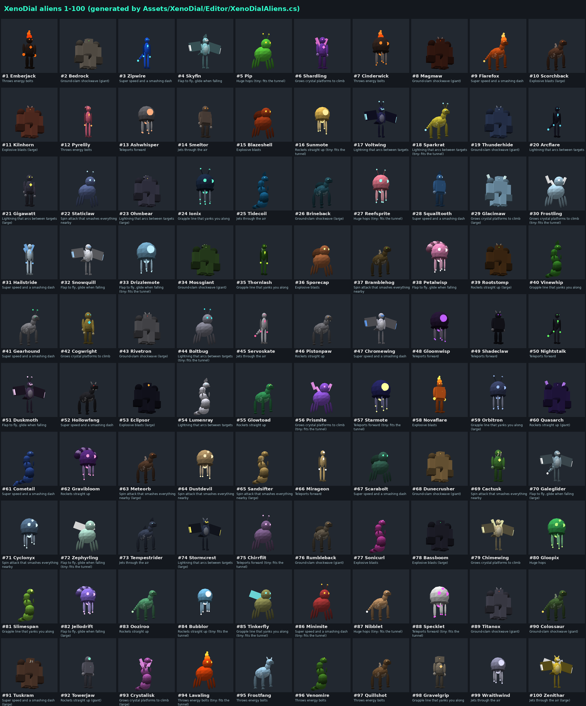

# XenoDial: an alien-transformation watch world for VRChat

A pod has crashed in the woods. Inside is the **XenoDial**, a watch that turns you into any of
**100 aliens**. Take it, spin the dial, slam the core, and you transform. Each alien changes how you
move (speed, jump, gravity and even your size) and gives you a power. Everyone in the instance
sees your alien and your powers. When the time runs out the watch turns red and has to recharge.

Everything is built from Unity primitives and synthesised sounds, so there are no outside assets
to download or license. It works on PC and Quest.

## The aliens



There are 100 original aliens across eight body plans: biped, brute, slim, avian, four-legged,
bug, floater and serpent. Each has its own colours and extras such as horns, tails, flames, crystals,
antennae, wings, shells, manes, tusks and extra arms. Each alien has one of 13 powers:

| Power | What it does | Aliens with it, for example |
|---|---|---|
| Fire | Throws a bolt where you point | Emberjack, Pyrelily, Frostfang |
| Blast | A bolt that explodes and smashes everything around where it lands | Scorchback, Novaflare, Bassboom |
| Lightning | Strikes what you point near, then arcs to two more targets | Voltwing, Gigawatt, Lumenray |
| Slam | Shockwave that smashes everything within 9 m | Bedrock, Magmaw, Titanox |
| Spin | Smashes everything right around you | Staticlaw, Bramblehog, Cyclonyx |
| Dash | Super speed plus a burst that smashes what you run through | Zipwire, Flarefox, Hollowfang |
| Blink | Teleports you about 10 m forward, stopping short of walls | Ashwhisper, Shadeclaw, Mirageon |
| Grapple | Fires a line; if it catches a wall you're yanked to it | Ionix, Thornlash, Vinewhip |
| Thrust | Hold to jet through the air where you aim | Smeltor, Tidecoil, Zenithar |
| Launch | Rockets you straight up | Rootstomp, Glowtoad, Towerjaw |
| Flap | Flap in mid-air to fly, glide when falling, low gravity | Skyfin, Snowquill, Galeglider |
| Hop | Big hops | Pip, Reefsprite, Gloopix |
| Crystal | Crystal platforms that everyone can stand on. Jump, then use it, to climb anything | Shardling, Glacimaw, Chimewing |

Sizes: **tiny** aliens (17 of them, such as Pip, Sparkrat and Frostling) shrink you to 30 cm eye height
and fit through the vault tunnel. **Large** aliens are 2.4 m and **giants** are 3.4 m with a huge jump. Everyone else keeps
your own size. Speeds, jump and gravity come from the power and size, with a little variation per alien.

A transformation lasts **45 s**. The watch beeps for the last 5 s, then you turn back and it
recharges for 8 s. If you change back yourself, the recharge only takes 2 s.

## Using the watch

| | VR | Desktop |
|---|---|---|
| Take the watch | Use the crashed pod | Use the crashed pod |
| Open the dial | Tap the core on your left wrist with your right index finger | **Q** |
| Pick an alien | Tap its hologram (ten are shown at a time) | **1–9, 0** on the current page, **← / →** one at a time |
| More aliens | Tap the **<** / **>** orbs beside the ring | **↑ / ↓** a page at a time, **R** for a random alien |
| Transform | Tap the core again | **F** |
| Use your power | Pull either trigger (hold it for Thrust) | **Left click** or **F** (hold F for Thrust) |
| Change back early | Tap the core | **Q** |

The dial shows each alien's number, name and power. The numbers match the **Alien Codex**.

In VR the watch sits on your left wrist and turns to face you. On desktop it sits at the
bottom-left of your view. Other players see the watch on your wrist, and your alien when you transform.
Your own alien is hidden from your own camera so it doesn't block your view. Turn on the **mirror** at the crash
site to see yourself.

## The world

```
                     Sky Tower (ring the bell)
                              |
                         crashed pod
  Speed Track -------- spawn + mirror -------- Training Arena
                              |
                     "too small" tunnel -> Pip Vault
                  Alien Codex (all 100 statues)
```

* **Crash site** (spawn): the pod with the watch floating above it, a how-to sign, a mirror and a signpost.
* **Training Arena** (east): nine floating drones for ranged powers and eight boulders for slams,
  spins and dashes. They burst for everyone and rebuild after 6 s. A board counts your smashes.
* **Sky Tower** (north): a 24 m pillar. The ledges are 1.5 m apart, which is too far for a
  normal jump. Fly, launch, grapple, jet or crystal-climb to the bell at the top.
  Everyone in the instance hears it ring.
* **Speed Track** (west): an oval with a start/finish gate and a halfway gate. Laps are timed and your best lap
  is saved between visits with VRChat persistence.
* **Pip Vault** (south): a rock mesa whose only way in is a tunnel 45 cm tall. Walk into it as any tiny alien
  and you're pulled through into the hidden room.
* **Alien Codex** (south-west): all 100 aliens as numbered statues, ten to a row in dial order, each with its power on a plaque.

## How it's built

| Piece | File |
|---|---|
| **The roster: one line per alien** (name, body, power, size, colours, extras) | `Assets/XenoDial/Data/aliens.txt` |
| Alien generator: body plans and extras, merged into a few vertex-coloured meshes per alien | `Assets/XenoDial/Editor/XenoDialAliens.cs` |
| The watch: wrist tracking, finger taps, keys, paged dial, timer, stats, all 13 powers | `Assets/XenoDial/Scripts/XenoDialWatch.cs` |
| Your synced alien: form, powers and effects for everyone (one per player, VRChat Player Objects) | `Assets/XenoDial/Scripts/XenoBody.cs` |
| Smashable drones and boulders | `XenoTarget.cs` |
| Lap timer and gates | `XenoRaceTimer.cs`, `XenoRaceGate.cs` |
| Pod, bell, vault tunnel, buttons | `XenoPod.cs`, `XenoBell.cs`, `XenoVaultDoor.cs`, `XenoButton.cs` |
| One-click scene builder (world, alien library, Codex) | `Assets/XenoDial/Editor/XenoDialWorldBuilder.cs` (menu **XenoDial > Build World**) |
| Shaders: toon colour with fog (and a vertex-colour version for aliens), and a hologram glow | `Assets/XenoDial/Shaders/` |
| Sound effects (synthesised) | `tools/make_sounds.py` → `Assets/XenoDial/Audio/` |
| Alien contact sheet without Unity (compiles the real generator with Mono) | `tools/preview_aliens/preview.sh` → `aliens.png` |
| `.unitypackage` / folder zip | `tools/make_unitypackage.py` |

How the pieces work:
* Size changes use `SetAvatarEyeHeightByMeters`. Your original height is restored when you change back,
  and kept for the alien if you swap avatars mid-transformation.
* Movement uses the player API (`SetWalkSpeed`, `SetRunSpeed`, `SetJumpImpulse`, `SetGravityStrength`, `SetVelocity`).
* Every alien's model exists once, in a hidden library. When someone transforms, their body copies that one model.
  The dial copies the ten it's showing. So a hundred aliens cost almost nothing until they're used.
* A model is about six meshes (body, swinging limbs, pulsing glow) sharing **one material**. It follows its player,
  scales to their avatar's height and swings its limbs while walking. Only the form number and the last power are
  synced, a few bytes per action.
* Smashes are network events, so targets burst for everyone. Crystals have real colliders on every client.

### Why it's Quest-friendly
There are no realtime lights, shadows, textures or post-processing. Every mesh is a primitive with a tiny shader
that has the sun's shading built in, and the scenery is static-batched. The mirror is off until you turn it on. The Codex is the heaviest spot, with 100 statues of about 1–3k triangles each, all static-batched. If Quest
frame rates drop there, hide `Environment/Alien Codex` in the Android build.

## Setup

1. Create a **world** project in the VRChat Creator Companion (Worlds SDK **3.7.0 or newer**, which is needed for
   Player Objects and persistence).
2. Build the package: `python vrchat-xenodial/tools/make_unitypackage.py` writes `XenoDial.unitypackage` and
   `XenoDial-folder.zip`. In Unity, import the package with **Assets > Import Package > Custom Package**. If it won't
   import, close Unity and unzip `XenoDial-folder.zip` into the project folder (next to `Assets`).
   You can also just copy `vrchat-xenodial/Assets/XenoDial` into your project's `Assets` folder.
3. Unity asks **"Set up XenoDial now?"**. Click **Set it up**, or use **XenoDial > One-Click Setup** later.
   It imports TextMeshPro's essentials, creates `Assets/XenoDial/XenoDial.unity` with the whole world
   built in, saves it and adds it to Build Settings.
4. Open **VRChat SDK > Show Control Panel > Builder** and use **Build & Test**. To publish for Quest too, switch the
   platform to Android and upload again.

Re-run **XenoDial > Build World** whenever you change the builder. It replaces the old `XenoDial` object.

### Adding or changing aliens
Edit `Assets/XenoDial/Data/aliens.txt`. Each line is one alien, and its comment header lists the body plans, powers, sizes
and extras. Add `*1.3` after a power to make it stronger. Then run **XenoDial > Build World**. The dial, bodies and Codex
all follow the file, and any number of aliens works. To see them without Unity, run `bash tools/preview_aliens/preview.sh`
(needs `mono-mcs`, Python, numpy and Pillow).

### Tuning
Base speeds, jump, gravity and cooldown per power are in the tables at the top of `XenoDialAliens.cs`.
Transformation time, recharge time, range and the desktop keys are fields on the **XenoDial System** object in the
scene. If powers don't leave along your hand on your controllers, adjust **Hand Pointer Euler** there.

## Testing notes
None of this has run inside Unity or VRChat yet. The alien generator compiles and runs (that's
how `aliens.png` is made), but the Udon scripts and the scene builder are only syntax-checked, not compiled against
the SDK. On the first Build & Test, check:
* the dial opens and tapping works with your avatar's finger bones (the watch falls back to controller tracking
  if an avatar has no finger bones);
* giant and tiny sizes. VRChat clamps eye height to the world's limits, and the watch sets those to 0.1–5 m;
* that other players see your alien and powers (test with a second client: **Build & Test** with 2 clients).
